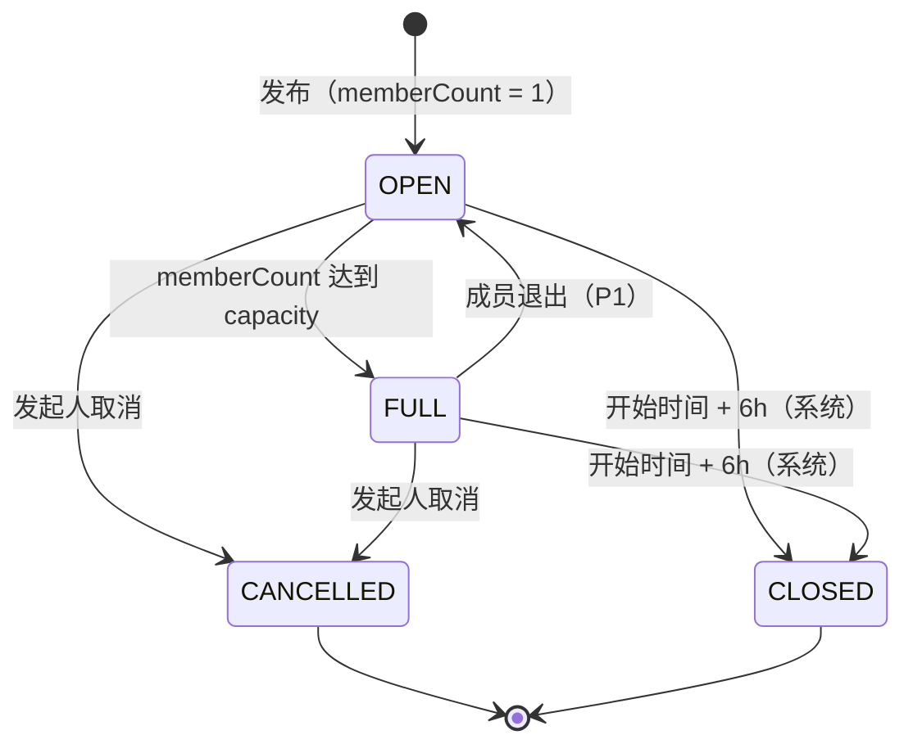
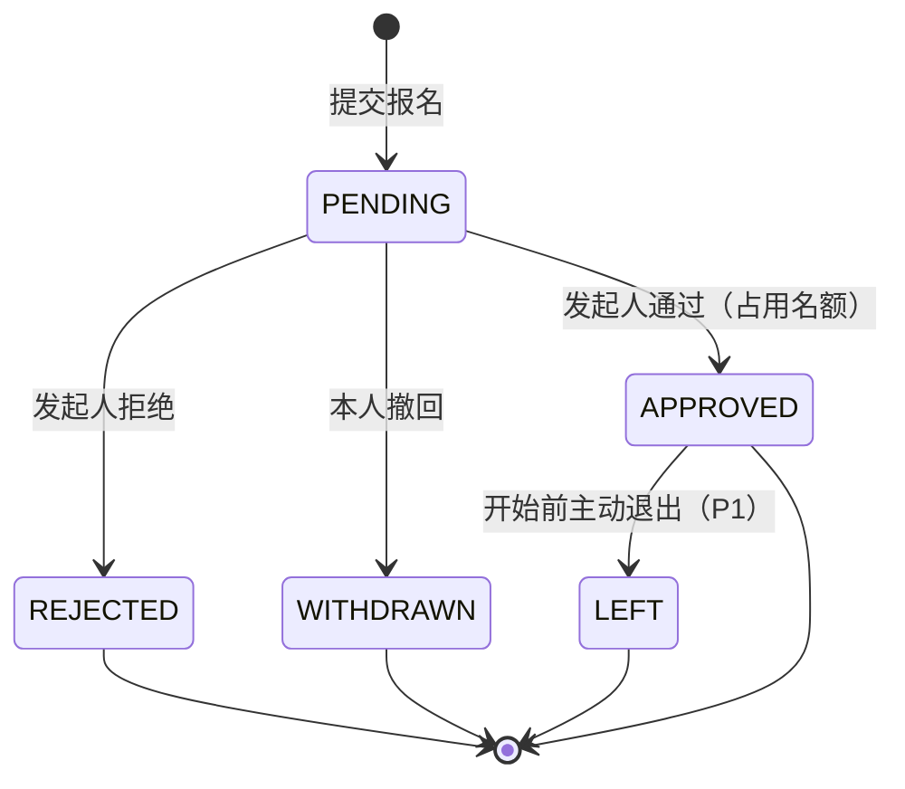

# PRD：AllieTeam —— 跨领域「找搭子 / 找队友」平台

| 项目 | 内容 |
| --- | --- |
| 文档版本 | v1.0 |
| 状态 | 待评审（Draft） |
| 覆盖范围 | V1（游戏领域）、V1.5（演唱会、旅游，已实现） |
| 相关文档 | `Tech Design.md`（技术方案）、`AGENTS.md`（工程约定） |

> 名称 `AllieTeam` 为占位名，正式名称可在评审后替换；文档中不依赖名称的业务含义。

---

## 1. 背景与问题

「一个人去没意思」的场景大量存在，但当前凑人方式都很低效：

- **演唱会**：独自排队入场、跨城看演出想找人拼房拼车、散场后没人一起吃饭。
- **游戏**：缺固定队友，游戏内公屏刷屏、临时组队一局就散，段位和语音习惯不匹配。
- **旅游**：想找人分摊住宿交通，但整团跟团游不自由、纯陌生人又担心安全。

现有渠道（贴吧、豆瓣小组、QQ/微信群、游戏公屏）的共同问题是：**信息非结构化、时效性差、没有名额与状态管理、缺少信用与安全机制**。发帖者被重复私信骚扰，报名者不知道局是否已满、发起人靠不靠谱。

## 2. 产品定位

**一句话**：帮用户在 10 分钟内找到「同一时间、同一场合、玩得来」的搭子，并走完从报名到见面/开黑的全流程。

**核心价值（与替代方案的差异）**：

1. **结构化招募卡**，不是水帖：时间、场合、人数、条件可被机器筛选和排序。
2. **名额与成团有状态机**：满员自动关闭，不再出现「满了还一直被问」。
3. **信用闭环**：互评 + 信誉分 + 举报，降低线下见面的不确定性。
4. **一局一聊天室**：报名通过后自动进群，不需要交换私人微信。

**不做什么**：不做社交广场/动态流，不做票务交易，不做语音房，不做赛事与战队系统。产品重心是「把一次活动的人凑齐」。

## 3. 目标用户

| 画像 | 典型场景 | 关键诉求 | 对产品的敏感点 |
| --- | --- | --- | --- |
| 演出党（20–30 岁，学生/白领） | 跨城看巡演，散场晚、住宿贵 | 同场次、同看台区域的同伴，拼房拼车 | 场次与座位信息准确性、性别与安全 |
| 游戏玩家（16–28 岁，男性为主） | 排位缺人、想找固定车队 | 段位接近、平台一致、是否开麦 | 响应速度、段位匹配、上线时间 |
| 旅行者（22–35 岁） | 假期出行，预算有限 | 日期重叠、目的地一致、消费习惯接近 | 预算透明度、行程强度、安全与实名 |

**首要服务对象**：游戏玩家。原因是匹配条件最客观（游戏 + 平台 + 段位 + 时间），验证成本最低，且不依赖线下见面，可以先跑通「招募—成团—沟通」内核。

## 4. 术语表

| 术语 | 含义 |
| --- | --- |
| 局 | 一次招募帖（数据模型中的 `Post`），是产品的核心对象 |
| 发起人 / host | 局的创建者，拥有审批与取消权限 |
| 搭子 / 队员 | 报名并被通过的用户 |
| 报名 | 用户对某个局提交申请（`Application`） |
| 成团 | 成员数达到名额上限（`capacity`） |
| 领域（domain） | 局的分类：游戏、演唱会、旅游 |

## 5. 目标与非目标

### 5.1 V1 目标（可验证）

- 单个用户能独立完成端到端闭环：注册 → 建游戏档案 → 发局 → 别人报名 → 审批成团 → 局内聊天 → 结束后互评。
- 发布一个结构化局不超过 3 分钟（含填写游戏档案）；从列表筛出目标局不超过 30 秒。
- 10 人并发抢 3 个名额时，**不出现超卖**（自动化并发测试覆盖）。
- 列表接口 p95 < 300ms（1000 条局数据规模下）。

### 5.2 非目标（V1 明确不做）

支付与票务转售、语音/视频、推荐算法、地图导航、战队与赛事、多语言、原生 App、动态信息流、私信（仅做局内聊天）。

## 6. 领域差异（V1.5 已实现）

三个领域共用「发布—筛选—报名—成团—聊天—评价」内核，差异只体现在**局的属性与筛选维度**上：

| 领域 | 独有属性 | 主要筛选条件 | 状态 |
| --- | --- | --- | --- |
| 游戏 | 游戏、平台（PC/主机/手游）、模式、段位区间、是否开麦 | 游戏、平台、段位、开始时间 | **V1 已实现**（含守望先锋、第五人格、Steam 小游戏） |
| 演唱会 | 艺人、巡演名、场馆、场次时间、看台/内场、是否已有票 | 艺人、城市、场次日期、座位区域 | **V1.5 已实现** |
| 旅游 | 目的地、起止日期、人均预算、交通方式、行程强度 | 目的地、出发日期、预算区间、交通方式 | **V1.5 已实现** |

**领域约束**：演唱会领域只做「找同行的人」，**不提供票务撮合与转售**，避免资质与法律风险；发帖需明确「票已自备 / 仅找同行」。

**旅游附加内容（V1.5 已实现）**：旅行页提供「国内热门徒步路线攻略」，内容为人工整理的静态信息，包括推荐时长、里程与累计爬升、最佳季节、逐日行程、携带物品、注意事项，以及示意路线小地图与海拔剖面。它只做行前参考，**不提供地图导航、轨迹下载、向导、救援、住宿与交通预订**；所有信息以景区当日公告为准。攻略详情页可以按路线直接发起旅行局，目的地自动预填。

## 7. 用户故事与验收标准

优先级：P0 = V1 必须；P1 = V1 尽力，可不做；P2 = 后续版本。

### US-01 注册与登录（P0）

作为新用户，我希望用邮箱注册并登录，以便参与活动。

- 邮箱 + 密码（≥ 8 位，含字母与数字）注册，邮箱唯一，重复注册返回明确错误。
- 登录成功返回访问令牌；关闭浏览器再回到站点仍保持登录（刷新令牌有效期 ≥ 14 天）。
- 密码错误 5 次/分钟后返回 429，并提示稍后再试。
- 手机号验证码登录在 V1 只保留接口与入口占位，不接短信服务商。

### US-02 完善游戏档案（P0）

作为玩家，我希望登记常玩游戏、平台、段位和是否开麦，以便系统推荐与筛选。

- 同一游戏 + 同一平台只能有一条档案，可修改段位。
- 支持添加多款游戏；至少一条档案后才允许发布游戏局（引导补齐）。
- 段位以自由文本保存（各游戏段位体系不同），预留枚举映射字段但不做排序。

### US-03 发布招募局（P0）

作为发起人，我希望用结构化表单发布一个局。

- 必填：标题、描述、游戏、平台、开始时间、名额（2–20）。
- 选填：模式、段位区间、是否要求开麦、城市、封面图（≤ 6 张）。
- 标题 8–40 字，描述 ≤ 1000 字；开始时间必须晚于当前时间。
- 发布成功后立即出现在列表首位，发起人自动成为成员（成员数从 1 开始计）。
- 未登录用户点击「发布」跳转登录，登录后回到发布页并保留已填内容（P1）。

### US-04 浏览与筛选（P0）

作为找队友的人，我希望快速筛出符合条件且还没满的局。

- 列表默认按开始时间升序，仅展示 `OPEN` 且开始时间未过的局。
- 可按游戏、平台、段位、时间范围、城市筛选；筛选条件体现在 URL 上，可分享。
- 分页使用游标；下拉/翻页不出现重复或漏项。
- 卡片展示：游戏、模式、段位要求、开始时间（相对时间，如「今晚 20:00」）、已报名/名额、发起人昵称与信誉分。

### US-05 报名（P0）

作为用户，我希望申请加入某个局。

- 可填写一句自我介绍（≤ 200 字）。
- 同一用户对同一局只能存在一条申请；被拒绝后 7 天内不可重复申请。
- 不能报名自己发布的局；已满、已取消、已开始的局不可报名，返回明确原因。
- 发起人可设置「自动通过」（P1），默认人工审批。

### US-06 审批与成团（P0）

作为发起人，我希望审批申请并在满员时自动关闭招募。

- 报名列表展示申请人昵称、游戏档案、信誉分、介绍。
- 通过后该用户立即获得聊天室权限，并收到通知。
- 通过最后一个名额后，局状态变为「已满」，之后不再接受新申请。
- 并发审批不会超出名额上限。
- 拒绝时可选填理由，申请人收到通知。

### US-07 局内聊天（P0）

作为成员，我希望在局内沟通细节。

- 仅发起人与已通过成员可进入聊天室；未通过用户访问返回 403。
- 消息实时到达（WebSocket），断线重连后能补齐断开期间的消息。
- 支持系统消息（「xxx 加入了」「局已满员」）。
- 单条消息 ≤ 500 字；不做图片与语音（P2）。

### US-08 我的局（P0）

作为用户，我希望管理自己发起的和参与的局。

- 「我发起的」：可取消局（需二次确认）、查看报名待处理数。
- 「我参与的」：显示局状态与开始时间；开始前 24 小时内可退出（P1）。
- 已结束的局折叠展示，并提示「去评价队友」。

### US-09 互评（P0）

作为参与者，我希望活动结束后评价队友，以积累信誉。

- 局开始 6 小时后进入「已结束」，成员可对同局其他成员各评价一次（1–5 星 + 可选标签/评论）。
- 同一对用户在同一局只能评价一次，不可修改。
- 评价后双方信誉分按公式更新（见 §8.4）。
- 评价内容在对方主页可见；不含评价不扣分，也不加分。

### US-10 举报（P0）

作为用户，我希望举报违规内容或用户。

- 可举报局、用户、消息，原因枚举：虚假信息、骚扰、广告、色情、诈骗、其他。
- 同一用户对同一目标 24 小时内只能举报一次。
- 举报进入后台待处理队列；管理员可下架局、封禁用户、驳回举报。
- 被举报对象不会收到举报人身份。

## 8. 业务规则

### 8.1 局的状态机

- `CLOSED` / `CANCELLED` 为终态，不可再报名、不可聊天（保留只读历史与评价入口）。
- 定时任务每 10 分钟扫描一次，把「开始时间 + 6 小时 < 当前时间」的 `OPEN`/`FULL` 局置为 `CLOSED`。
- 取消局时，所有成员收到通知，报名记录保留（用于统计与评价判定）。

### 8.2 报名状态机

### 8.3 名额规则

- `memberCount` 包含发起人，初始为 1；`capacity ∈ [2, 20]`。
- 只有「报名状态 PENDING → APPROVED」和「成员退出」两个动作会改变 `memberCount`。
- `memberCount` 的变更必须以带条件的原子更新执行（详见 `Tech Design.md` §6.2），禁止「先查后写」。
- 发起人退出即视为取消局，不走成员退出逻辑。

### 8.4 信誉分

- 初始 60 分，区间 0–100。
- 每收到一条评价：`newScore = clamp(round(0.6 × 旧分 + 0.4 × rating × 20), 0, 100)`，四舍五入取整。
- 举报成立（管理员判定）：-10，且不恢复。
- 信誉分 < 40 时，发布局需人工审核（P2）；V1 仅在列表中展示，并按信誉分对申请排序。
- 信誉分变动写入日志表，便于客服追溯（P1）。

### 8.5 内容与频率限制

| 规则 | 阈值 |
| --- | --- |
| 单人每日发局数 | 10 |
| 单人每日报名数 | 30 |
| 单局标题长度 | 8–40 字 |
| 单局描述长度 | ≤ 1000 字 |
| 单局图片数 | ≤ 6 张，单张 ≤ 5MB，仅 jpg/png/webp |
| 单条消息长度 | ≤ 500 字 |
| 登录尝试 | 5 次/分钟/IP |

超出限制返回 `429 RATE_LIMITED` 或在表单层直接拦截。

## 9. 信息架构与页面清单

| 路由 | 页面 | 说明 | 优先级 |
| --- | --- | --- | --- |
| `/` | 局列表（首页） | 筛选栏 + 卡片列表 + 游标加载 | P0 |
| `/login`、`/register` | 登录 / 注册 | 邮箱密码 | P0 |
| `/posts/new` | 发布局 | 结构化表单 | P0 |
| `/posts/[id]` | 局详情 | 信息、成员、报名按钮/审批区、聊天入口 | P0 |
| `/posts/[id]/chat` | 局内聊天 | WebSocket | P0 |
| `/me` | 我的资料 | 资料 + 游戏档案管理 | P0 |
| `/me/posts` | 我发起的 | 管理、取消、待审批 | P0 |
| `/me/applications` | 我参与的 | 状态与退出 | P0 |
| `/notifications` | 通知列表 | | P1 |
| `/admin/reports` | 举报处理 | 仅管理员 | P0（极简版） |

## 10. 非功能需求

**性能**：列表接口 p95 < 300ms（1000 局规模）；详情接口 p95 < 200ms；首屏在 4G 下 < 2.5s；WebSocket 消息端到端 < 500ms（同区域）。

**可用性**：目标 99.5%（可接受单次 < 10 分钟的计划外中断）；数据库每日备份，保留 7 天。

**安全**：所有写操作做所有权校验（只有作者能改/取消局，只有发起人能审批）；令牌与密码不明文落库；上传做 MIME 与大小校验；接口限流；不在日志中记录密码、令牌、手机号明文。

**合规**：仅收集必要个人信息；不接入票务交易；未成年人（< 18）在演唱会、旅游领域需显式提示并禁止发布含住宿合住内容的局；提供账号注销与数据删除入口（P1）。

**移动端优先**：所有页面按 375px 宽度设计，触控目标 ≥ 44px；桌面端为增强布局。

**可访问性**：表单控件有 label，键盘可完成报名与审批，对比度符合 WCAG AA。

## 11. 指标

**北极星指标**：每周「成团并产生 ≥ 3 条聊天消息」的局数。

| 指标 | 定义 | V1 目标 |
| --- | --- | --- |
| 发局数 | 每周新建局数 | 通过种子用户达到 50 |
| 报名转化 | 报名数 / 局详情浏览量 | > 8% |
| 成团率 | 达到 capacity 的局 / 已开始局 | > 40% |
| 审批时效 | 报名到审批的中位时长 | < 2 小时 |
| 互评率 | 已结束局中产生评价的比例 | > 30% |
| 举报率 | 举报数 / 局数 | < 2% |
| 7 日留存 | 注册后第 7 天仍活跃 | > 25% |

## 12. 里程碑

| 阶段 | 交付 | 退出标准 |
| --- | --- | --- |
| M0 筹备 | 本 PRD、技术设计、脚手架、本地数据库 | 一条命令拉起本地环境 |
| M1 账号 | 注册登录、资料、游戏档案 | US-01/02 全部验收项通过 |
| M2 发布与浏览 | 发局、列表筛选、游标分页、图片上传、种子数据 | US-03/04 通过，列表 p95 达标 |
| M3 报名成团 | 报名、审批、成团、并发控制 | US-05/06 通过，并发测试无超卖 |
| M4 沟通 | WebSocket 局内聊天、通知 | US-07/08 通过 |
| M5 信任 | 互评、信誉分、举报与极简后台 | US-09/10 通过 |
| M6 上线 | E2E、限流、监控、生产部署 | 手机上完成完整闭环 |

## 13. 风险与未决问题

| 风险 | 影响 | 缓解 |
| --- | --- | --- |
| 冷启动无人发局 | 列表为空，用户流失 | 首期只做单一热门游戏（如英雄联盟/无畏契约）+ 种子内容；允许「求组队」不带具体时间的局 |
| 线下安全事件 | 品牌与法律风险 | 实名（P1）、信誉分、举报、局内聊天不暴露手机号、禁止未成年人参与合住类局 |
| 票务合规 | 下架风险 | 演唱会领域仅做同行匹配，明令禁止票务转售 |
| 垃圾信息与广告 | 体验恶化 | 新账号发局频控 + 内容敏感词过滤 + 人工审核队列 |
| 并发超卖 | 数据不一致、纠纷 | 原子更新 + 唯一索引 + 并发测试（见技术设计 §6.2） |
| 消息量增长 | 单机内存吃紧 | WebSocket 使用 Redis adapter，消息落库并限制历史分页 |

**未决问题（需产品/技术负责人确认）**：

1. 是否需要「局主付费置顶」等商业化能力？（V1 不做，但数据模型预留 `promotedUntil`）
2. 手机号验证是否在 V1 上线前强制？（当前 V1 不强制）
3. 评价是否双向可见、是否允许申诉？（当前为单向展示、无申诉）
4. 演唱会领域是否允许发布跨城拼车？（涉及交通责任，建议默认允许但需免责提示）
